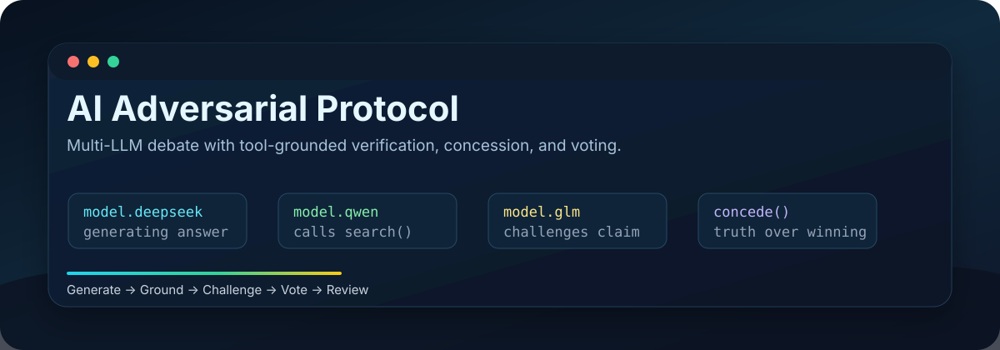
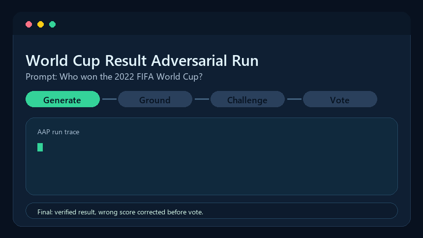
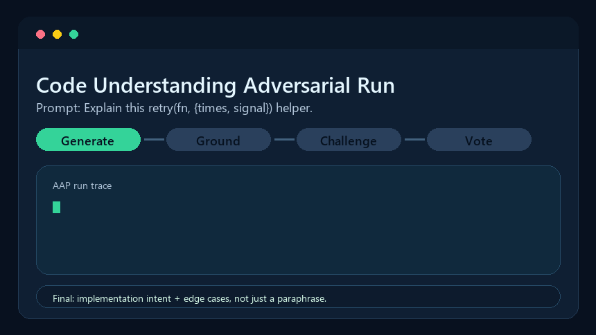
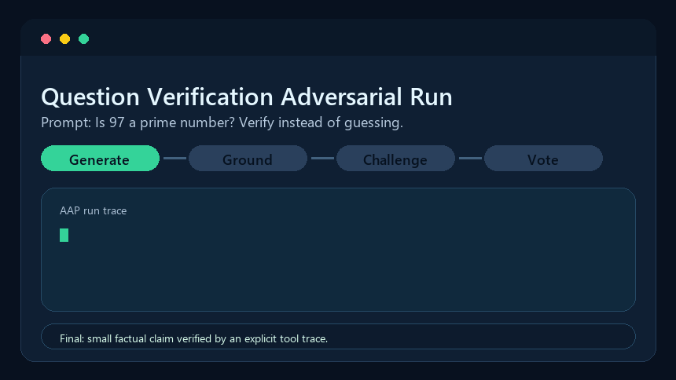

<div align="center">



# 🥊 AI Adversarial Protocol

**Multiple LLMs answer the same question, audit each other, ground claims in tools, and only keep what survives scrutiny.**

让多个 LLM 围绕同一个问题独立作答 → 互相挑刺 → 调用外部工具求证 → 错的主动认错 → 投票收敛 — 比单模型答案更接近"真"。

[](https://github.com/laochendeai/ai-adversarial-protocol/actions/workflows/ci.yml)
[](https://www.npmjs.com/package/ai-adversarial-protocol)
[](https://www.npmjs.com/package/ai-adversarial-protocol)
[](https://github.com/laochendeai/ai-adversarial-protocol/releases)
[](LICENSE)
[](https://nodejs.org)
[](CONTRIBUTING.md)
[](https://github.com/laochendeai/ai-adversarial-protocol/stargazers)

[English](README.md) · **简体中文**

[`npm install -g ai-adversarial-protocol`](https://www.npmjs.com/package/ai-adversarial-protocol) · [快速开始](#-quick-start) · [FAQ](docs/FAQ.zh-CN.md) · [路线图](docs/ROADMAP.zh-CN.md) · [支持](SUPPORT.md) · [贡献](CONTRIBUTING.zh-CN.md)

</div>

---

## 项目定位

**AAP（AI Adversarial Protocol）** 是一个 Node.js CLI + HTTP Server，让你把任意数量、任意服务商的 LLM 编入一个**对抗式协作流水线**：

```
                  ┌──── Phase 1: Generating ────┐
                  │  N 个模型并行独立作答         │
                  └──────────────┬───────────────┘
                                 ▼
                  ┌──── Phase 2: Tool Grounding (可选) ─┐
                  │  search / fetch_url / exec_python    │
                  │  错了的模型 concede() 主动退出       │
                  └──────────────┬───────────────────────┘
                                 ▼
                  ┌──── Phase 3: 结构化黑板 ─────────┐
                  │  claim / 证据 / 共识风险          │
                  │  身份漂移 / 少数派保护            │
                  └──────────────┬───────────────────┘
                                 ▼
                  ┌──── Phase 4: Auto-Challenge ────┐
                  │  每个模型审计其他模型的输出      │
                  │  标注事实错误/逻辑漏洞/遗漏      │
                  │  挑刺结果回写结构化黑板          │
                  └──────────────┬───────────────────┘
                                 ▼
                  ┌──── Phase 5: Voting ────────────┐
                  │  多模式投票（majority/weighted/   │
                  │  consensus/unanimous）           │
                  │  共识不足 → 标"需人工"，不强造结果 │
                  └──────────────────────────────────┘
                                 │
                                 ▼
                  Multi-round（默认 2 轮）：第二轮 prompt
                  含上一轮回答 + 挑刺，让模型修正
```

**为什么要做对抗：** 单 LLM 的 RLHF 偏置会让它对自己不知道的事情自信地编造。多 LLM 投票天然放大同向偏置（训练数据重叠 → 错得一致 → 多数票通过）。引入**外部工具接地** + **主动认错** + **同行 audit** 是把"求真"放在"听起来完整"之上的工程化路径。

## 为什么是 AAP

| 方案 | 常见问题 | AAP 的处理方式 |
|---|---|---|
| 单模型 | 回答很快，但自信幻觉难发现 | 把每个回答都当成需要被挑战的 claim |
| 朴素多模型投票 | 训练数据重叠会导致一起错、一起投 | 要求互相挑刺、证据来源和明确的"需人工审查"状态 |
| 只靠工具的 agent | 工具有帮助，但模型仍可能夸大证据 | 显示真实 tool calls，让同行审计，并允许 `concede()` |
| AAP | 生成、接地、挑战、修正、投票 | 宁可承认不确定，也不制造假 winner |

## Demo Gallery

下面这些动图展示同一套协议在不同任务里的运行轨迹：独立作答、可选工具接地、结构化黑板、互相挑刺、修正和投票。

| 世界杯结果对抗 | 代码理解对抗 |
|---|---|
|  |  |

| 问题求证 | 标准理解 |
|---|---|
|  |  |

---

## ✨ Features

### 多模型对抗
- 任意服务商混搭：OpenAI / Anthropic / Ollama 协议都支持，OpenAI 兼容代理（如 SiliconFlow、各种本地多模型网关）也走得通
- **多轮对抗**：默认最少 2 轮、最多 4 轮；修正轮会看到上一轮回答、挑刺和黑板控制信号
- **自适应轮次**：`maxRounds` 是安全上限，不是“已经求真”的信号；达到最小轮数后，如果仍有中/高严重性挑刺或黑板强制修正，会继续运行，到上限仍未解决则标记需复核
- **加权投票**：每个模型可设权重；模式可选 majority / weighted / consensus / unanimous

### 求真接地（Tier 3）
- **工具调用** 由模型自主发起：
  - `search` — 通过本地 SearXNG 搜索互联网
  - `fetch_url` — 抓取 URL 验证内容
  - `exec_python` — 沙箱执行（一次性 Docker，`--network none`，stdlib only）
  - `repo_list_files` / `repo_search` / `repo_read_file` — 可选本地仓库审计工具，只能访问配置过的 root
  - `repo_run_command` — 可选验证命令工具，只执行 allowlist 中完全匹配的命令
  - `concede` — **主动认错退出**：模型见到证据后承认错误、可选 defer to 同行
- **Capability probe**：自动探测每个模型对 tool-calling 的真实支持，结果缓存 24h；不可靠的模型在工具运行时被自动剔除
- **本地仓库安全边界**：repo 工具默认关闭、只读、root 白名单、限制行数/字节、密钥脱敏，并硬排除 `.git`、`dist`、`assets`、`node_modules`、Python 环境、缓存和生成产物
- **当前日期注入**：每个 prompt 自动带 system 消息告知"今天是 X 年 X 月 X 日"，避免模型把训练截止时间当成"现在"
- **求真 > 收敛**：投票若不达共识，输出"需人工审查"而非强造 winner

### 用户意见参与对抗
- 用户意见会被拆成可验证 claim，不会被当成投票权或事实来源
- 用户提供的证据链接会被抓取、摘要，并进入 claim review prompt
- 输出包含采纳 / 反驳 / 部分采纳 / 证据不足、证据状态、采纳矩阵和精简证据图
- 反附和评分会下调“盲审阶段没有依据、看到用户意见后无证据支持”的模型本轮投票权重

### 结构化黑板协议
- 每一轮生成后都会更新结构化 claim、证据引用、共识簇和 controller 事件
- 模型互相挑刺会回写进黑板，并转成下一轮修正指令
- 对低独立证据的多数一致做风险标记，避免把“两个模型说法一致”直接当成真
- 少数派差异 claim 会被保留下来等待裁决，不被多数措辞覆盖
- 如果运行时模型声称自己是另一个模型家族，会输出身份漂移信号，并反馈到模型画像评分

### 结构化裁决与预测模型
- 通用概率预测框架：base rate、加权 signal、不确定性区间、Brier Score、Log Loss
- 世界杯冠军概率 MVP：rating / 近期状态 / 阵容健康 / 赛程路径 + 确定性种子模拟
- 美国总统竞选 MVP：提名概率 × 大选胜率，支持州级 Electoral College signal
- 标准冲突裁决：适用范围、上位/下位、强制/推荐、专门/通用、生效日期、替代和过渡期

### 可观察性
- **TUI**（基于 ink）实时显示：
  - 每个模型的流式输出 + token 计数
  - 顶部最终求真结果：代表答案、置信度、是否需复核、停止原因
  - 互相挑刺（类型/严重性/置信度/原文片段/理由）
  - 工具调用面板（哪个模型调了什么、ok/失败、结果预览）
  - 结构化黑板（每轮 claim、注册挑刺、共识风险、身份漂移、少数派保护、修正指令）
  - Concession 高亮区块
  - 投票分布
  - 多轮进度
- **审计评分**：每个模型的累计 reliability score（A+ ~ D），持久化在 `~/.aap/audit-metrics.json`

### 部署灵活
- 单一进程同时跑 TUI + HTTP Server
- HTTP 接口兼容 OpenAI `/v1/chat/completions` 和 Anthropic `/v1/messages`
- 可作为 Claude Code / Cursor / 自研 agent 的"上游"——所有外部请求自动走对抗，TUI 实时可见

---

## 🚀 Quick Start

### 1. 安装

从 npm 安装：

```bash
npm install -g ai-adversarial-protocol
aap --help
```

或从源码安装：

```bash
git clone git@github.com:laochendeai/ai-adversarial-protocol.git
cd ai-adversarial-protocol
npm install
npm run build
npm link               # 全局可用 aap 命令（可选）
```

不 link 的源码运行方式：`npm run dev`。

### 2. 配置模型（**交互式，最简单**）

```bash
aap config add
```

会顺序问你：endpoint base URL → 协议 → API key → 自动调上游 `/v1/models` 列出可用模型 → 多选添加。一次可加多个 endpoint。

也支持脚本式：

```bash
aap config add deepseek-v3 \
  --protocol openai \
  --base-url https://api.example.com/v1 \
  --api-key sk-... \
  --model deepseek-ai/DeepSeek-V3.2
```

或纯发现（不写入）：

```bash
aap config discover --base-url https://api.example.com/v1 --protocol openai --api-key sk-...
```

服务商配置注意：
- OpenAI-compatible 第三方平台通常使用 `--protocol openai`，base URL 以 `/v1` 结尾。
- Anthropic 原生协议没有公开 model-list 接口；需要手动指定 `--model`。
- API key 只放在本机 `~/.aap/config.json`，不要发到 issue、PR、日志或聊天记录。

### 3. （可选）启用工具求真模式

```bash
# 部署本地 SearXNG（搜索后端）
bash scripts/start-searxng.sh

# 探测每个模型的 tool-calling 支持
aap probe

# 看探测结果 + 工具配置
aap tools list

# 可选：允许一个本地仓库 root 进入受控、只读的代码审计工具
aap tools repo add /path/to/your/repo

# 编辑 ~/.aap/config.json，把 adversarial.tools.enabled 改 true
```

AAP server、搜索服务、模型平台是三类地址：AAP 默认 `127.0.0.1:28788`；SearXNG 常用 `127.0.0.1:28080`；模型服务商是各自的 `/v1` endpoint。

本地仓库审计工具不会给模型裸磁盘权限。它只暴露配置过的 root，排除大型/敏感目录，只返回有限代码片段或 allowlist 命令输出。没有文件、行号或测试输出支撑的代码缺陷结论，应视为证据不足。

### 4. 启动

```bash
aap                      # TUI + Server 一起跑
aap --no-tui             # 只 Server（headless 部署）
aap --no-server          # 只 TUI
aap --port 9000          # 改端口
```

---

## 🖥 TUI 操作

| 键 | 动作 |
|---|---|
| `n` | 新建对抗（先选模型，再输入问题） |
| `a` | 添加模型（直接调出发现界面） |
| `↑` / `↓` | 在 run 列表里切换 |
| `q` / `Ctrl+C` | 退出 |

`n` 弹窗里：空格切换模型勾选，Enter 确认 → 输入问题 → Enter 触发。

按 `n` 提交后会先跑 **preflight**（去重 endpoint、ping `/v1/models` 验证模型可用性）。失败时给三选项：drop 失败的、放弃、强制继续。

---

## 🌐 HTTP API

服务默认监听 `http://127.0.0.1:28788`。`model` 字段决定行为：

| `model` 值 | 行为 |
|---|---|
| `adversarial:all` | 调用所有 enabled 模型，并行返回 |
| `adversarial:vote` | 全部模型 + 投票，主响应是获胜方答案 |
| `adversarial:debate` | 全部模型 + 挑刺，主响应是合并的多模型输出 |
| `adversarial:m1,m2,m3` | 指定参与的模型 id |
| `qwen-235b` | 直接透传，不做对抗 |

### OpenAI 兼容

```bash
curl -X POST http://127.0.0.1:28788/v1/chat/completions \
  -H "Content-Type: application/json" \
  -d '{
    "model": "adversarial:vote",
    "messages": [{"role":"user","content":"用一句话解释熵"}],
    "user_opinion": "答案应该提到微观状态。",
    "user_evidence": ["https://example.com/evidence"]
  }'
```

响应是标准 OpenAI Chat Completion 格式，多了一个 `x_adversarial` 扩展字段（含 responses / structuredDeliberation / challenges / voting / 用户意见裁决 / 证据抓取结果 / 采纳矩阵 / 工具调用日志）。

流式：加 `"stream": true`，按标准 OpenAI SSE 输出，每个模型用 `## modelId` markdown header 分隔；最后一个 chunk 携带 `x_adversarial`，再发 `data: [DONE]`。

### Anthropic 兼容

```bash
curl -X POST http://127.0.0.1:28788/v1/messages \
  -H "Content-Type: application/json" \
  -H "anthropic-version: 2023-06-01" \
  -d '{
    "model": "adversarial:debate",
    "max_tokens": 1024,
    "messages": [{"role":"user","content":"1+1=?"}]
  }'
```

返回标准 Anthropic Message 格式（`type: "message"`, `content: [{type:"text",...}]`），同样带 `x_adversarial`。流式遵循 Anthropic 的 `message_start` / `content_block_delta` / `message_delta` / `message_stop` 协议。

### 接入 Claude Code

```bash
export ANTHROPIC_BASE_URL=http://127.0.0.1:28788
export ANTHROPIC_AUTH_TOKEN=any
claude
```

或在 `~/.claude/settings.json` 里写死。Claude Code 的每次请求会被多模型对抗后再返回，TUI 可以同步看到。

---

## 🧰 命令参考

```
aap                              # 默认：TUI + Server
aap --no-tui|--no-server         # 单独模式
aap --port <n> | --host <addr>

aap config init                  # 初始化配置
aap config list                  # 列出所有模型
aap config add [<id>]            # 添加（带 id = 脚本式；不带 id = 交互式）
aap config discover --...        # 探活 endpoint，列出可用模型
aap config remove <id>           # 删除
aap config enable|disable <id>   # 启停
aap config path                  # 打印 config.json 路径

aap probe [ids...] [--all]       # 探测 tool-calling 能力
aap tools list                   # 显示工具配置 + 模型能力状态
aap tools repo add <path>        # 添加一个本地仓库 root，供受控只读审计工具使用
aap tools repo list              # 查看本地仓库 roots 和限制
aap profile list                 # 查看模型画像、附和风险和投票权重倍率
aap calibration add --model <id> --task-type <type> --probability <0-1> --outcome true|false
aap calibration summary          # 查看事后结果回填后的校准汇总
```

TUI 中 `[n]` 会直接启动盲答 run。盲答出现后，在选中的 run 上按 `[u]` 追加用户意见或证据链接，把它们作为待验证 claim 参与审查。

---

## 📁 持久化

`~/.aap/`：
- `config.json` — 模型 + 服务器配置
- `audit-metrics.json` — 每个模型的累计 reliability score
- `capabilities.json` — tool-calling 能力探测缓存（TTL 24h）
- `model-profiles.json` — 每次运行自动生成的模型表现事件，用于下次动态调权
- `calibration-memory.json` — 事后真实结果回填记录，用于概率校准

---

## 🏗 架构

AAP 现在是 **Node.js CLI + HTTP 协议服务**。它不是 Next.js 应用、Tailwind 页面、浏览器 Web UI、本地大型知识库，也不是某个领域的预测器。

```text
┌──────────────────────── aap Node.js 进程 ────────────────────────┐
│                                                                  │
│  CLI / TUI (Ink)  ───┐                ┌─── HTTP Server (Hono)    │
│                      └── EngineHub ───┘     全局事件总线          │
│                              │                                   │
│                     AdversarialEngine                            │
│                          每次运行一个                            │
│                              │                                   │
│  盲答生成 → 结构化黑板更新 → 自动挑刺                            │
│       → 挑刺回写黑板 → 自适应轮次控制                            │
│       → 用户意见 claim 审查 → 投票 → 协议输出                    │
│                              │                                   │
│  ModelClient: OpenAI-compatible | Anthropic | Ollama             │
│  Tools/plugins: search | fetch | exec | local repo | probes      │
└──────────────────────────────────────────────────────────────────┘
```

技术形态：
- **运行时**：Node.js 20+、TypeScript、ESM。
- **TUI**：Ink（`src/tui/`），和 HTTP run 共用同一个 `EngineHub` 事件流。
- **服务端**：Hono + `@hono/node-server`（`src/server/`），提供 OpenAI-compatible 和 Anthropic-compatible 路由。
- **打包**：`tsup` 把 `src/cli.ts` 打成 `dist/cli.js`；React/Ink 相关包作为运行时 external。
- **配置**：`~/.aap/config.json` 是本地唯一配置源，保存模型 endpoint、协议、服务端、对抗、工具和存储配置。
- **模型协议**：OpenAI-compatible chat completions、Anthropic messages、Ollama chat 由 `ModelClient` 统一封装。
- **搜索/工具**：不能默认假设模型自带搜索能力；是否参与搜索由 AAP 的能力探测和工具循环配置决定。

核心协议模块：
- `structured-deliberation` 是按轮次持续更新的黑板控制器，不是一次性摘要；它累积 `rounds`、`claims`、`evidenceRefs`、`challengeRefs`、`events`、`revisionDirectives`。
- `claim-graph` 把用户 claim、模型 claim、证据、挑刺、冲突和 verdict 用 support/refute/qualify/depend/conflict 边连成证据-对抗图。
- `user-opinion` 只在模型盲答之后接入用户自由文本和证据链接，并记录采纳/反驳、证据链和附和风险。
- `model-profile` 与 `calibration-memory` 只保存轻量行为元数据，让后续 run 根据真实表现调角色和投票权重，而不是按服务商名气硬编码。
- `output-contract` 强制输出最终结论、置信度、证据链、冲突点、用户 claim 采纳/反驳、附和风险，以及不确定性/复核条件。

轮次控制是自适应的：默认至少 2 轮、最多 4 轮。`maxRounds` 只是安全上限，不代表已经求真；如果还有中/高严重性挑刺或黑板强制修正未解决，会在输出中标记为需要复核。

HTTP 响应仍保持标准 OpenAI/Anthropic-compatible 格式，并通过 `x_adversarial.structuredDeliberation` 携带全过程、按轮次累积的黑板数据。

详见 [ARCHITECTURE.md](ARCHITECTURE.md)。

---

## 🛠 开发

```bash
npm run dev              # tsx src/cli.ts（直接跑源码）
npm run build            # tsup 打包到 dist/cli.js
npm run type-check       # tsc --noEmit
npm test                 # vitest --run
npm run test:watch       # vitest 监视模式
```

构建产物：单一 ~150 KB ESM 文件 + sourcemap，运行时只依赖 `react/ink/ink-*`（external）。

测试规则：见 [TESTING.md](TESTING.md)。
项目协作约定：见 [AGENTS.md](AGENTS.md) 和 [CONTRIBUTING.md](CONTRIBUTING.md)。

---

## 📦 发布

本包已发布到 npm：[`ai-adversarial-protocol`](https://www.npmjs.com/package/ai-adversarial-protocol)。

安装：

```bash
npm install -g ai-adversarial-protocol
```

发布流程使用 npm Trusted Publishing (OIDC)，不使用 `NPM_TOKEN`。

npm package settings 中需要这样配置：

- Provider: GitHub Actions
- Organization/user: `laochendeai`
- Repository: `ai-adversarial-protocol`
- Workflow filename: `release.yml`
- Environment: 留空
- Publishing access: `Require two-factor authentication and disallow tokens (recommended)`

在 `main` 上提升版本号后，推送 `v*` tag 即可发布：

```bash
git tag v0.1.2
git push origin v0.1.2
```

Release workflow 会依次执行 type-check、tests、build，然后执行 `npm publish --access public`。

---

## 🗺 Roadmap

详见 [docs/ROADMAP.zh-CN.md](docs/ROADMAP.zh-CN.md)，包括当前计划、适合新贡献者的方向和明确的非目标。

---

## 友情链接

- [linux.do](https://linux.do/) - 面向开发者和 AI 工具用户的社区。

---

## 📜 License

[MIT](LICENSE) © 2026

---

<div align="center">

**做这个项目的初衷：让"多模型协作"从直觉式的"听起来更稳妥"变成可验证的"求真工程"。**

If you find this useful, a ⭐ on GitHub helps a lot.

</div>
